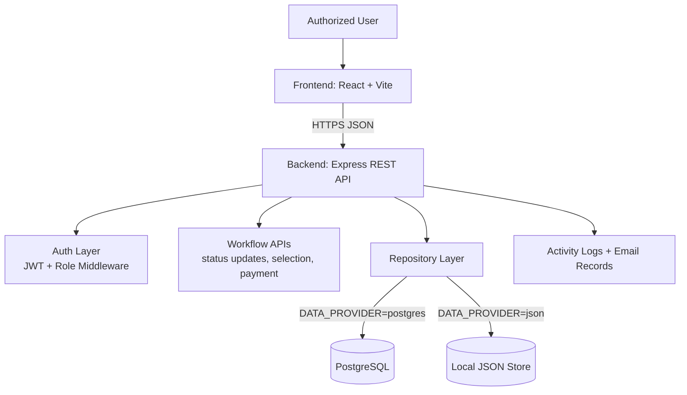
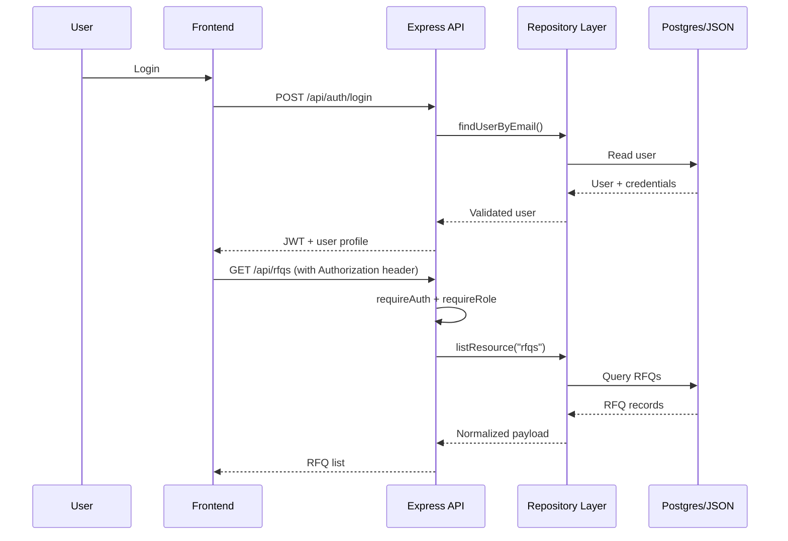

# SDEMS — Secure Digital Document Management System

> Smart India Hackathon 2026 submission-style documentation for the `kapil31jangid/VendorBridge` repository.

## Smart India Hackathon 2026 Context

| Field | Value |
|---|---|
| Hackathon | Smart India Hackathon (SIH) 2026 |
| Problem Statement ID | **26190** |
| Problem Title | **Secure Digital Document Management System for Legal and Investigation Documents** |
| Theme / Category | Smart Automation / GovTech (documentation-aligned) |
| Team Name | **ThreeSixNine** |
| Solution Branding | **SDEMS** |
| Repository | [`kapil31jangid/VendorBridge`](./) |

---

## Project Overview

This repository contains a full-stack prototype that can be presented in **SDEMS style** for SIH 2026:

- `frontend/`: React + Vite dashboard and workflow UI
- `backend/`: Express REST API with JWT authentication, role checks, workflow transitions, and analytics summary
- Persistence modes:
  - `postgres` (production-like mode with schema + seed + DB constraints)
  - `json` (local/demo fallback mode)

> Note: The current codebase uses domain entities such as vendors, RFQs, quotations, approvals, purchase orders, invoices, and activity logs. In SIH/SDEMS framing, these represent secure document lifecycle records and approval workflows.

---

## Architecture

### High-Level Architecture



### Core Request Flow



---

## Current Functional Scope (Code-Backed)

### Implemented API Modules

- **Auth**: login, register, session user (`/api/auth/login`, `/api/auth/register`, `/api/auth/me`)
- **Resource collections**: users, vendors, rfqs, quotations, approvals, purchase-orders, invoices, activity-logs, emails
- **Workflow operations**:
  - vendor/rfq/quotation status updates
  - quotation selection
  - invoice payment
  - email send logging
  - analytics summary (`/api/analytics/summary`)
- **Document fetch endpoints**:
  - `/api/documents/invoices/:id`
  - `/api/documents/purchase-orders/:id`

### Frontend Modules

UI pages include login/register, dashboard, vendors, RFQ creation, quotations, comparison, approvals, purchase orders, invoices, activity logs, and reports.

---

## Technical Stack

### Frontend
- React 19
- Vite 8
- lucide-react
- ESLint

### Backend
- Node.js (ESM)
- Express 4
- JWT (`jsonwebtoken`)
- Password hashing (`bcryptjs`)
- CORS
- dotenv

### Data Layer
- PostgreSQL (`pg`) with schema initialization (`npm run db:init`)
- JSON fallback persistence for local/demo mode

---

## Security & Cryptography

The repository already includes several security-oriented controls:

1. **JWT-based authentication**
   - Signed access tokens with expiration (`12h`)
   - Authorization header enforcement in protected routes
2. **Role-based authorization**
   - Route-level role checks for Admin / Officer / Manager / Vendor actions
3. **Credential handling**
   - Password hashing with `bcryptjs` in PostgreSQL-backed flows
4. **Audit integrity guardrail (PostgreSQL mode)**
   - `activity_logs` update/delete operations blocked by DB trigger to keep logs immutable

### Important implementation note

`DATA_PROVIDER=json` is useful for demos/tests, but it is not a hardened production mode. For deployment-oriented usage, run with `DATA_PROVIDER=postgres` and a strong `JWT_SECRET`.

---

## Repository Structure

```text
VendorBridge/
├─ README.md
├─ backend/
│  ├─ package.json
│  ├─ .env.example
│  ├─ src/
│  │  ├─ api/
│  │  ├─ auth/
│  │  ├─ config/
│  │  ├─ data/
│  │  ├─ db/
│  │  ├─ middleware/
│  │  ├─ app.js
│  │  ├─ server.js
│  │  └─ seed.js
│  └─ test/
│     └─ api.test.js
└─ frontend/
   ├─ package.json
   ├─ src/
   │  ├─ components/
   │  ├─ context/
   │  ├─ pages/
   │  ├─ App.jsx
   │  └─ main.jsx
   └─ public/
```

---

## Local Setup

### Prerequisites

- Node.js 20+
- npm
- PostgreSQL (recommended for primary runtime)

### 1) Backend Setup

```bash
cd backend
npm install
```

Create `.env` from `.env.example` and update values:

```env
PORT=5000
JWT_SECRET=replace-with-a-long-random-secret
DATA_PROVIDER=postgres
PGHOST=localhost
PGPORT=5432
PGUSER=postgres
PGPASSWORD=your-postgres-password
PGDATABASE=vendorbridge
```

Initialize schema + seed data:

```bash
npm run db:init
```

Run backend:

```bash
npm start
```

Health check: `GET http://localhost:5000/api/health`

### 2) Frontend Setup

```bash
cd frontend
npm install
npm run dev
```

Optional `frontend/.env`:

```env
VITE_API_URL=http://localhost:5000/api
```

---

## Testing & Verification

### Backend tests

```bash
cd backend
npm test
```

### Frontend quality/build checks

```bash
cd frontend
npm run lint
npm run build
```

---

## Seed Access (Demo)

Default seeded users (password: `password123`):

- `officer@vendorbridge.com` (Officer)
- `manager@vendorbridge.com` (Manager)
- `vendor1@infra.com` (Vendor)
- `vendor2@techcore.com` (Vendor)
- `admin@vendorbridge.com` (Admin)

---

## Feasibility, Benchmarking, and Current Readiness

### Feasibility

- Monorepo setup keeps frontend/backend integration simple for SIH demo cycles.
- Dual-provider data mode helps fast local demos while preserving a PostgreSQL-backed path.
- Existing workflow APIs cover document lifecycle primitives: create, review, status transition, and audit visibility.

### Benchmarking (current codebase level)

- Baseline API health endpoint exists for service checks.
- Backend test suite validates authentication and protected route behavior.
- Analytics endpoint provides summary counters and spend aggregation for dashboard-level tracking.

> No formal load-test or cryptographic performance benchmark scripts are present in this repository yet.

### Impact potential

With domain adaptation to legal/investigation records, this architecture can support:
- controlled document access,
- approval traceability,
- tamper-aware logging patterns,
- and operational transparency for administrative teams.

---

## Product Roadmap (SDEMS Alignment)

- [ ] Stronger cryptographic controls for stored documents (at-rest encryption strategy)
- [ ] Evidence/document classification and case-linked metadata templates
- [ ] Fine-grained policy model (beyond role-only) for legal/investigation use cases
- [ ] Secure document upload/download pipeline with hash verification
- [ ] Compliance dashboards and export-ready audit packs
- [ ] Performance and resilience benchmarking suite

---

## References

- Smart India Hackathon: https://www.sih.gov.in/
- Node.js: https://nodejs.org/
- Express: https://expressjs.com/
- PostgreSQL: https://www.postgresql.org/
- JSON Web Tokens (RFC 7519): https://www.rfc-editor.org/rfc/rfc7519
- Mermaid (for architecture diagrams): https://mermaid.js.org/

---

## Repository Notes

- `backend/.env` is local-only and must not be committed.
- PostgreSQL init script creates DB objects and seeds data if users table is empty.
- Activity log immutability trigger is applied in PostgreSQL initialization.
