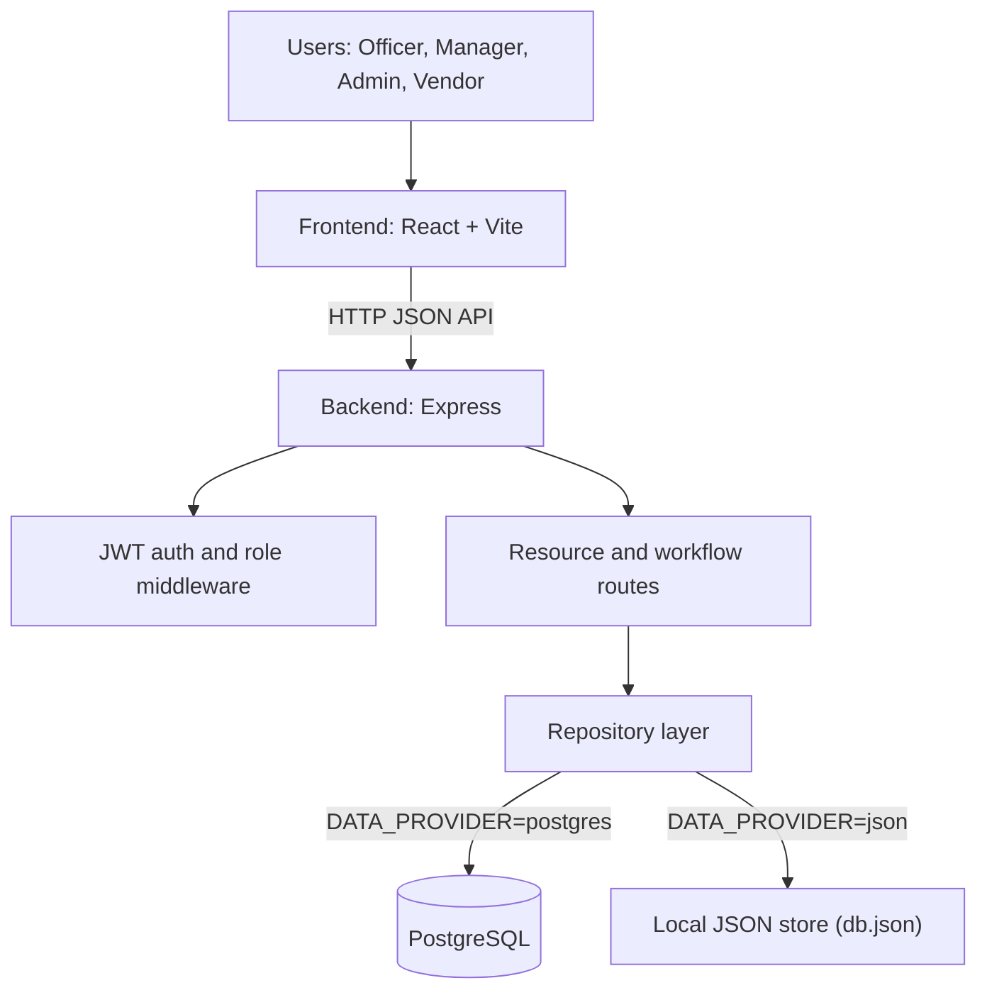
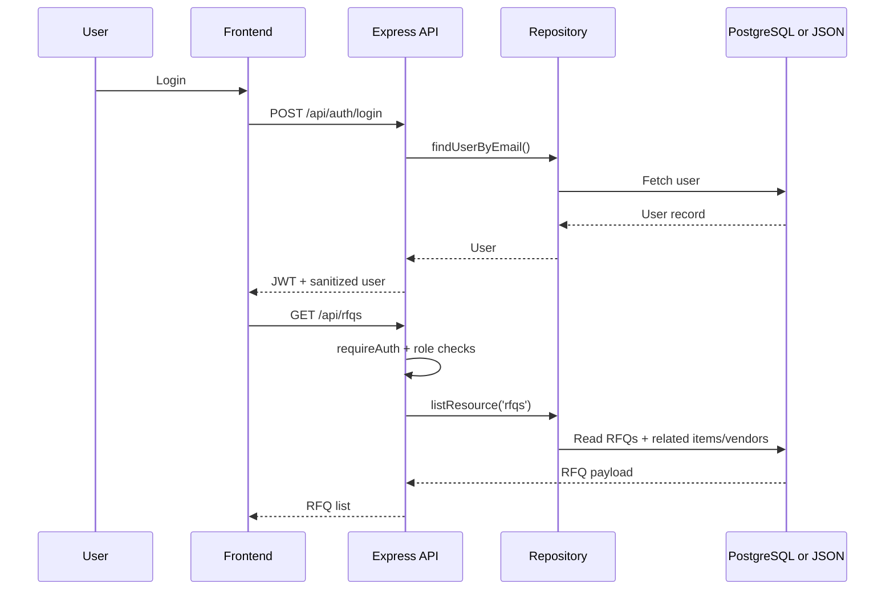

<div align="center">

# VendorBridge

### Procurement workflow platform connecting internal teams and vendors across RFQ → quotation → approval → PO → invoice


</div>

VendorBridge is a full-stack ERP-style procurement application for managing vendor onboarding, RFQs, quotations, approvals, purchase orders, invoices, and activity logs. The codebase includes a React frontend, an Express API backend, and dual persistence modes (PostgreSQL or local JSON fallback).

---

## Table of Contents

- [Executive Overview](#executive-overview)
- [Problem vs Solution](#problem-vs-solution)
- [Architecture](#architecture)
- [Technical Stack](#technical-stack)
- [Core Features and Workflows](#core-features-and-workflows)
- [Security, Access Control, and Data Integrity](#security-access-control-and-data-integrity)
- [Current Implementation vs Roadmap](#current-implementation-vs-roadmap)
- [Feasibility, Limitations, and Mitigations](#feasibility-limitations-and-mitigations)
- [Stakeholder Benefits](#stakeholder-benefits)
- [Repository Structure](#repository-structure)
- [Local Setup](#local-setup)
- [Environment Configuration](#environment-configuration)
- [Scripts and Commands](#scripts-and-commands)
- [Testing and Verification](#testing-and-verification)
- [Contribution and Support](#contribution-and-support)
- [License](#license)

---

## Executive Overview

Procurement operations often break down across disconnected spreadsheets, manual approvals, and email chains. VendorBridge centralizes these steps into one workflow-oriented product where teams can:

- manage vendors and RFQs,
- collect and compare quotations,
- run L1/L2-style approvals,
- generate purchase-order and invoice records,
- track activity and summary analytics.

The backend exposes REST endpoints for these resources and workflow transitions, while the frontend provides role-aware screens for Officer, Manager, Admin, and Vendor users.

## Problem vs Solution

| Problem | VendorBridge approach |
|---|---|
| Vendor/procurement data scattered across tools | Unified frontend + API resource model (`vendors`, `rfqs`, `quotations`, `approvals`, `purchase-orders`, `invoices`, `activity-logs`, `emails`) |
| Manual approval handoffs are hard to trace | Explicit workflow endpoints for status transitions, quotation selection, and invoice payment |
| Inconsistent access boundaries | JWT authentication + role-based route restrictions on backend and role-filtered navigation in frontend |
| Local demos/testing vs production-like runtime needs | Switchable persistence: `DATA_PROVIDER=json` fallback or `DATA_PROVIDER=postgres` for database-backed operation |

## Architecture

### High-level architecture



### Typical request flow



## Technical Stack

### Frontend
- React 19
- Vite 8
- lucide-react (icons)
- ESLint 10

### Backend
- Node.js (ES modules)
- Express 4
- jsonwebtoken (JWT)
- bcryptjs (password hashing)
- dotenv, cors

### Persistence
- PostgreSQL (`pg`) with schema/seed initializer (`backend/src/db/init.js`)
- JSON-file fallback store (`backend/src/store.js`, `backend/src/data/db.json` generated at runtime)

## Core Features and Workflows

### Implemented modules
- **Auth**: `/api/auth/login`, `/api/auth/register`, `/api/auth/me`
- **Resource collections**: `/api/users`, `/api/vendors`, `/api/rfqs`, `/api/quotations`, `/api/approvals`, `/api/purchase-orders`, `/api/invoices`, `/api/activity-logs`, `/api/emails`
- **Workflow actions**:
  - `PUT /api/vendors/:id/status`
  - `PUT /api/rfqs/:id/status`
  - `PUT /api/quotations/:id/status`
  - `POST /api/quotations/:id/select`
  - `PUT /api/invoices/:id/pay`
  - `POST /api/emails/send`
  - `GET /api/analytics/summary`
- **Document fetch endpoints**:
  - `GET /api/documents/invoices/:id`
  - `GET /api/documents/purchase-orders/:id`

### Frontend workflow coverage
- Login/register and session restore
- Dashboard and role-aware navigation
- Vendor management and status updates
- RFQ creation and vendor assignment
- Quotation submission/comparison flow
- L1/L2 approval UI path
- Purchase order and invoice screens
- Activity log and report views
- Email outbox log panel

## Security, Access Control, and Data Integrity

### Implemented now
- **JWT access tokens** (`12h` expiry) for authenticated API access
- **Role-based authorization** on write/workflow routes
- **User sanitization** removing password fields from API responses
- **Hashed passwords** in PostgreSQL mode (`bcryptjs`)
- **Audit-log immutability trigger** in PostgreSQL mode (`activity_logs` update/delete blocked)

### Important operational notes
- JSON mode is useful for local demos/tests and fallback behavior.
- PostgreSQL mode is the production-oriented path in this repository.
- Set a strong `JWT_SECRET` for non-local environments.

### Planned / not implemented as dedicated modules
- Fine-grained policy engine beyond current role checks
- Document encryption/key-management layer
- External identity provider integrations

## Current Implementation vs Roadmap

### Verified current implementation
- Full frontend + backend monorepo for procurement workflows
- Dual persistence strategy (PostgreSQL + JSON fallback)
- Seed data and bootstrapping utilities
- Basic backend test coverage for health/auth/protected routes/workflow update

### Practical roadmap opportunities
- Expanded automated test coverage (frontend + integration)
- Stronger validation/business-rule enforcement per route
- Better reporting screens based on live analytics rather than static UI blocks
- Production deployment artifacts (containerization/infra docs)
- Enhanced observability and audit exports

## Feasibility, Limitations, and Mitigations

| Area | Current limitation | Mitigation path |
|---|---|---|
| Persistence mode | JSON fallback is not a hardened production store | Run with `DATA_PROVIDER=postgres` and initialize via `npm run db:init` |
| Frontend behavior | Some screens include static/demo-style report values | Tie all report widgets to backend analytics endpoints and add tests |
| Test depth | Backend tests exist; frontend end-to-end checks are script-based and optional | Add CI automation for targeted integration and UI checks |
| Access control model | Role-based checks only | Add finer-grained permissions where needed |

## Stakeholder Benefits

- **Procurement teams**: centralized RFQ-to-invoice lifecycle visibility
- **Approvers (Manager/Admin)**: clearer approval workflow and status traceability
- **Vendors**: standardized quotation interaction model
- **Operations/leadership**: summary analytics and activity tracking in one system

## Repository Structure

```text
VendorBridge/
├─ README.md
├─ backend/
│  ├─ .env.example
│  ├─ package.json
│  ├─ src/
│  │  ├─ api/
│  │  ├─ auth/
│  │  ├─ config/
│  │  ├─ data/
│  │  ├─ db/
│  │  ├─ middleware/
│  │  ├─ app.js
│  │  ├─ server.js
│  │  ├─ seed.js
│  │  └─ store.js
│  └─ test/
│     └─ api.test.js
└─ frontend/
   ├─ package.json
   ├─ eslint.config.js
   ├─ vite.config.js
   ├─ scripts/
   │  └─ audit-buttons.mjs
   ├─ public/
   └─ src/
      ├─ components/
      ├─ context/
      ├─ pages/
      ├─ App.jsx
      └─ main.jsx
```

## Local Setup

### Prerequisites
- Node.js 20+
- npm
- PostgreSQL (optional but recommended for DB mode)

### 1) Backend

```bash
cd /home/runner/work/VendorBridge/VendorBridge/backend
npm install
cp .env.example .env
```

Run in JSON mode (default in `.env.example`) or set PostgreSQL mode in `.env` and initialize DB:

```bash
npm run db:init
```

Start backend:

```bash
npm start
```

Health endpoint:

```text
GET http://localhost:5000/api/health
```

### 2) Frontend

```bash
cd /home/runner/work/VendorBridge/VendorBridge/frontend
npm install
npm run dev
```

Frontend default API target is `http://localhost:5000/api`. You can override it with:

```env
VITE_API_URL=http://localhost:5000/api
```

## Environment Configuration

### Backend `.env` keys

```env
PORT=5000
JWT_SECRET=vendorbridge-dev-secret
DATA_PROVIDER=json
PGHOST=localhost
PGPORT=5432
PGUSER=postgres
PGPASSWORD=postgres
PGDATABASE=vendorbridge
```

`DATA_PROVIDER=postgres` enables PostgreSQL repository paths. Any other value uses JSON fallback.

## Scripts and Commands

### Backend (`/backend`)
- `npm run dev` – watch mode server
- `npm start` – start server
- `npm run db:init` – create/initialize PostgreSQL schema and seed data
- `npm test` – run Node test suite

### Frontend (`/frontend`)
- `npm run dev` – start Vite dev server
- `npm run build` – production build
- `npm run lint` – ESLint checks
- `npm run preview` – preview production build
- `npm run audit:buttons` – Playwright-based UI button/navigation audit script

## Testing and Verification

### Backend tests

```bash
cd /home/runner/work/VendorBridge/VendorBridge/backend
npm test
```

### Frontend quality checks

```bash
cd /home/runner/work/VendorBridge/VendorBridge/frontend
npm run lint
npm run build
```

### Seed demo accounts
Default seed users currently include:
- `officer@vendorbridge.com`
- `manager@vendorbridge.com`
- `admin@vendorbridge.com`
- `vendor1@infra.com`
- `vendor2@techcore.com`

(Seed password in repository seed data: `password123`)

## Contribution and Support

- Open issues/PRs with clear reproduction steps and expected behavior.
- Keep frontend and backend changes scoped and documented.
- For environment/setup issues, include your `.env` mode (`json` vs `postgres`) when reporting.

## License

No license file is currently present in this repository.
